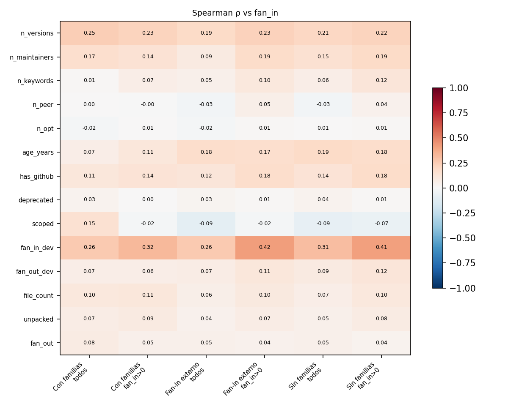
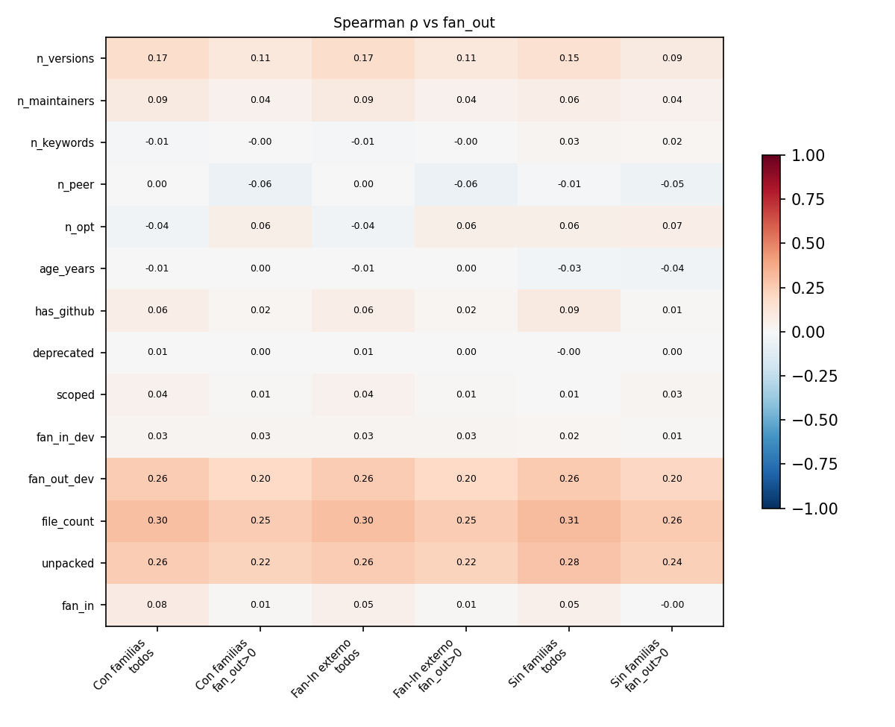
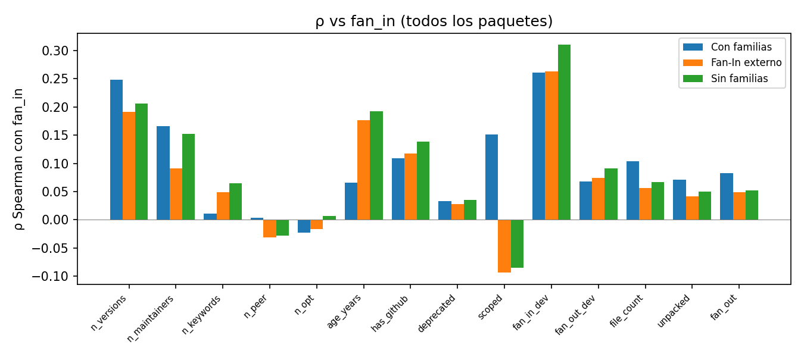
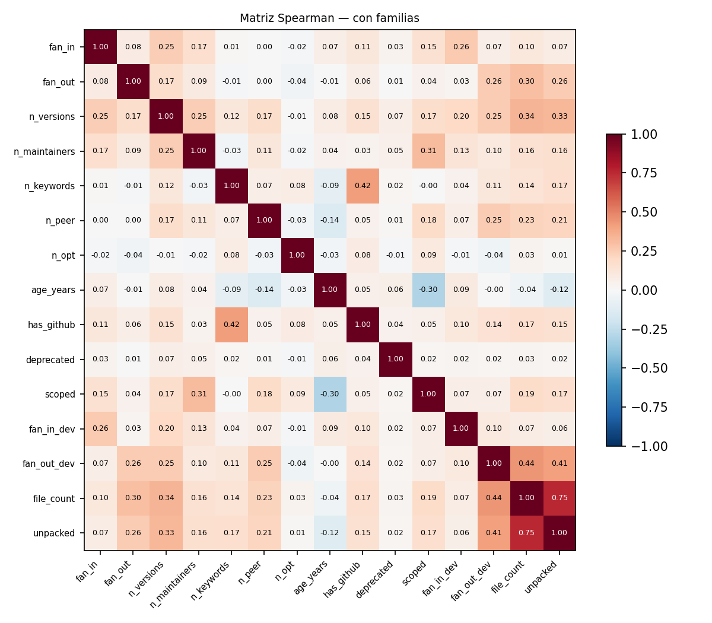
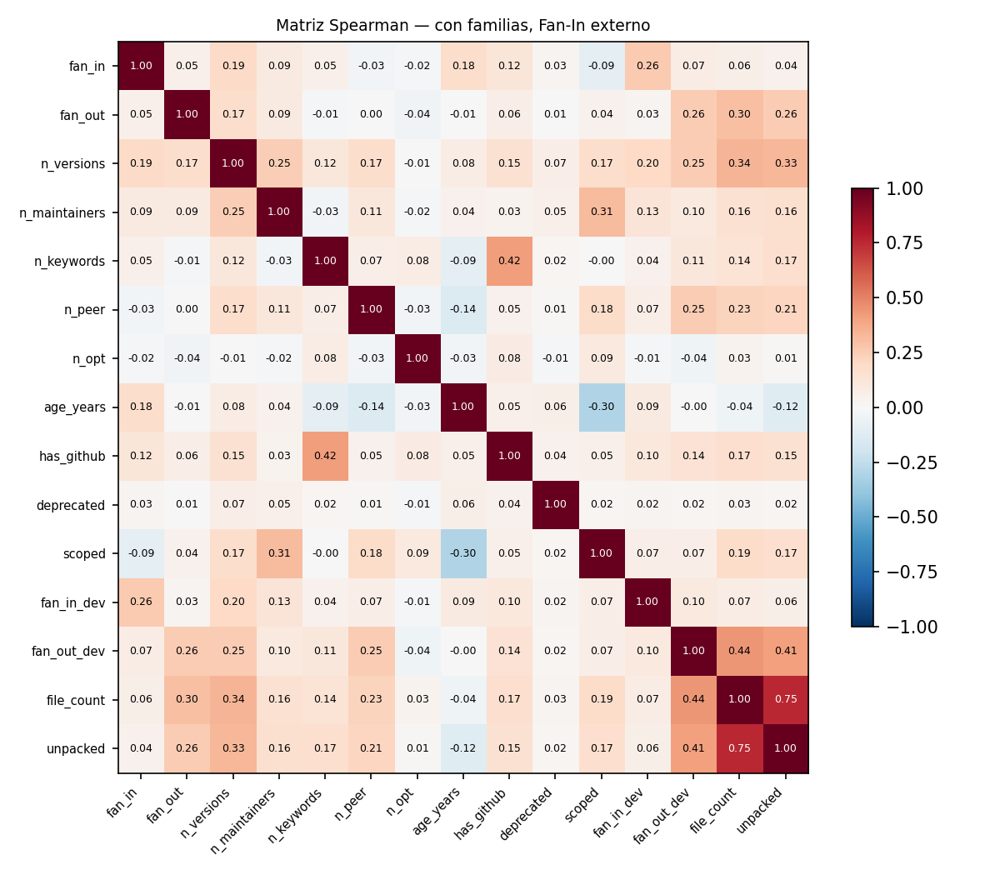
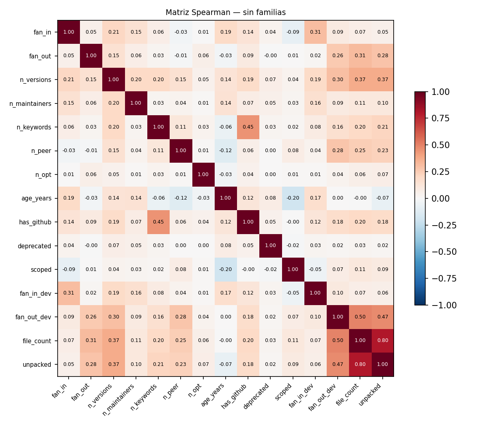
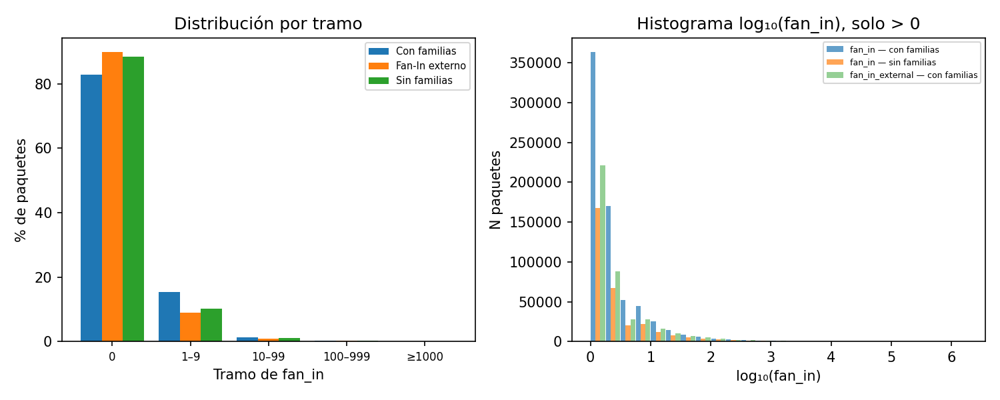
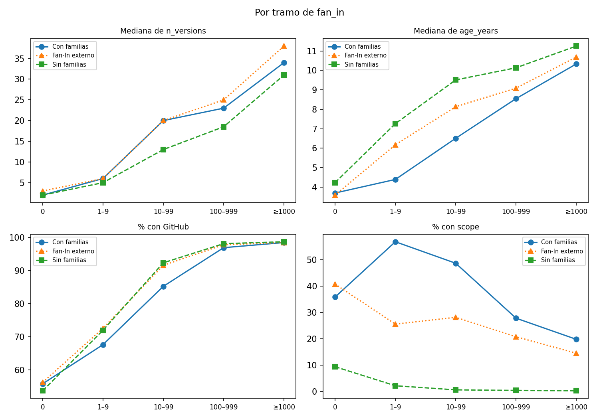
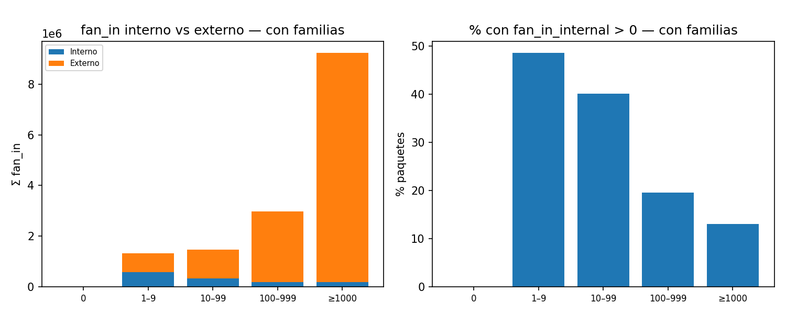

# Dataset: con familias

## 1. Tamaño y ceros

Paquetes: 4.080.297

| Celda | N | % |
|-------|---|---|
| fan_in=0 & fan_out=0 | 1.297.827 | 31,8 % |
| fan_in=0 & fan_out>0 | 2.084.853 | 51,1 % |
| fan_in>0 & fan_out=0 | 187.615 | 4,6 % |
| fan_in>0 & fan_out>0 | 510.002 | 12,5 % |

## 2. Estadísticos por variable

% cero y los percentiles se calculan sobre los valores presentes.

| Variable | % faltante | % cero | Mediana | p90 | p99 | Máx |
|----------|------------|--------|---------|-----|-----|-----|
| fan_in | 0,0 % | 82,9 % | 0,0 | 1,0 | 18,0 | 195.952 |
| fan_in_internal | 0,0 % | 91,9 % | 0,0 | 0,0 | 5,0 | 8.323 |
| fan_in_external | 0,0 % | 89,8 % | 0,0 | 1,0 | 13,0 | 195.952 |
| fan_out | 0,0 % | 36,4 % | 1,0 | 9,0 | 34,0 | 1.000 |
| fan_in_dev | 0,0 % | 94,3 % | 0,0 | 0,0 | 8,0 | 1.224.874 |
| fan_out_dev | 0,0 % | 41,9 % | 2,0 | 17,0 | 45,0 | 881 |
| n_versions | 0,0 % | 0,0 % | 3,0 | 24,0 | 251,0 | 37.328 |
| n_maintainers | 0,0 % | 0,0 % | 1,0 | 2,0 | 11,0 | 754 |
| n_keywords | 0,0 % | 49,0 % | 1,0 | 8,0 | 17,0 | 1.939 |
| n_peer | 0,0 % | 79,2 % | 0,0 | 2,0 | 7,0 | 708 |
| n_opt | 0,0 % | 98,4 % | 0,0 | 0,0 | 1,0 | 106 |
| file_count | 11,8 % | 0,0 % | 10,0 | 79,0 | 1.028,0 | 64.887 |
| unpacked | 11,8 % | 0,0 % | 36.436,0 | 1.350.757,6 | 33.176.805,1 | 5.963.579.668 |
| age_years | 0,0 % | — | 3,9 | 9,5 | 12,9 | 15 |

| Variable | % verdaderos |
|----------|--------------|
| has_github | 58,1 % |
| deprecated | 3,2 % |
| scoped | 39,3 % |

## 3. Spearman vs fan_in

| Variable | Todos | fan_in > 0 |
|----------|-------|------------|
| n_versions | +0,248 | +0,226 |
| n_maintainers | +0,166 | +0,144 |
| n_keywords | +0,011 | +0,065 |
| n_peer | +0,004 | -0,000 |
| n_opt | -0,023 | +0,006 |
| age_years | +0,066 | +0,112 |
| has_github | +0,109 | +0,136 |
| deprecated | +0,033 | +0,001 |
| scoped | +0,151 | -0,020 |
| fan_in_dev | +0,261 | +0,323 |
| fan_out_dev | +0,068 | +0,064 |
| file_count | +0,103 | +0,114 |
| unpacked | +0,071 | +0,087 |
| fan_out | +0,082 | +0,048 |

## 4. Spearman vs fan_out

| Variable | Todos | fan_out > 0 |
|----------|-------|-------------|
| n_versions | +0,173 | +0,106 |
| n_maintainers | +0,090 | +0,041 |
| n_keywords | -0,013 | -0,005 |
| n_peer | +0,000 | -0,058 |
| n_opt | -0,037 | +0,061 |
| age_years | -0,007 | +0,005 |
| has_github | +0,065 | +0,018 |
| deprecated | +0,007 | +0,004 |
| scoped | +0,041 | +0,008 |
| fan_in_dev | +0,029 | +0,026 |
| fan_out_dev | +0,258 | +0,200 |
| file_count | +0,300 | +0,255 |
| unpacked | +0,257 | +0,223 |
| fan_in | +0,082 | +0,013 |

## 5. Pares redundantes (|ρ| > 0,7)

| Variable A | Variable B | ρ |
|------------|------------|---|
| file_count | unpacked | +0,755 |

## 6. Tabla por tramo de fan_in

| Tramo | N | % | Med n_versions | Med age_years | Med file_count | % GitHub | % scoped | % deprecated | Σ fi_internal | Σ fi_external | % fi_internal>0 |
|-------|---|---|----------------|---------------|----------------|----------|----------|-------------|---------------|---------------|------------------|
| 0 | 3.382.680 | 82,9 % | 2,0 | 3,7 | 10,0 | 55,8 % | 35,9 % | 3,0 % | 0 | 0 | 0,0 % |
| 1–9 | 630.654 | 15,5 % | 6,0 | 4,4 | 13,0 | 67,6 % | 56,9 % | 4,5 % | 582.080 | 735.179 | 48,6 % |
| 10–99 | 55.208 | 1,4 % | 20,0 | 6,5 | 16,0 | 85,2 % | 48,7 % | 4,9 % | 327.697 | 1.142.867 | 40,1 % |
| 100–999 | 9.734 | 0,2 % | 23,0 | 8,5 | 13,0 | 96,9 % | 27,9 % | 5,0 % | 182.026 | 2.801.224 | 19,6 % |
| ≥1000 | 2.021 | 0,0 % | 34,0 | 10,3 | 13,0 | 98,5 % | 19,8 % | 3,1 % | 193.609 | 9.045.482 | 13,0 % |

# Dataset: con familias, Fan-In externo

Población A, con fan_in contado solo desde otros scopes (fan_in_external).

## 1. Tamaño y ceros

Paquetes: 4.080.297

| Celda | N | % |
|-------|---|---|
| fan_in=0 & fan_out=0 | 1.365.970 | 33,5 % |
| fan_in=0 & fan_out>0 | 2.298.763 | 56,3 % |
| fan_in>0 & fan_out=0 | 119.472 | 2,9 % |
| fan_in>0 & fan_out>0 | 296.092 | 7,3 % |

## 2. Estadísticos por variable

% cero y los percentiles se calculan sobre los valores presentes.

| Variable | % faltante | % cero | Mediana | p90 | p99 | Máx |
|----------|------------|--------|---------|-----|-----|-----|
| fan_in | 0,0 % | 89,8 % | 0,0 | 1,0 | 13,0 | 195.952 |
| fan_in_internal | 0,0 % | 91,9 % | 0,0 | 0,0 | 5,0 | 8.323 |
| fan_in_external | 0,0 % | 89,8 % | 0,0 | 1,0 | 13,0 | 195.952 |
| fan_out | 0,0 % | 36,4 % | 1,0 | 9,0 | 34,0 | 1.000 |
| fan_in_dev | 0,0 % | 94,3 % | 0,0 | 0,0 | 8,0 | 1.224.874 |
| fan_out_dev | 0,0 % | 41,9 % | 2,0 | 17,0 | 45,0 | 881 |
| n_versions | 0,0 % | 0,0 % | 3,0 | 24,0 | 251,0 | 37.328 |
| n_maintainers | 0,0 % | 0,0 % | 1,0 | 2,0 | 11,0 | 754 |
| n_keywords | 0,0 % | 49,0 % | 1,0 | 8,0 | 17,0 | 1.939 |
| n_peer | 0,0 % | 79,2 % | 0,0 | 2,0 | 7,0 | 708 |
| n_opt | 0,0 % | 98,4 % | 0,0 | 0,0 | 1,0 | 106 |
| file_count | 11,8 % | 0,0 % | 10,0 | 79,0 | 1.028,0 | 64.887 |
| unpacked | 11,8 % | 0,0 % | 36.436,0 | 1.350.757,6 | 33.176.805,1 | 5.963.579.668 |
| age_years | 0,0 % | — | 3,9 | 9,5 | 12,9 | 15 |

| Variable | % verdaderos |
|----------|--------------|
| has_github | 58,1 % |
| deprecated | 3,2 % |
| scoped | 39,3 % |

## 3. Spearman vs fan_in

| Variable | Todos | fan_in > 0 |
|----------|-------|------------|
| n_versions | +0,191 | +0,231 |
| n_maintainers | +0,091 | +0,185 |
| n_keywords | +0,049 | +0,105 |
| n_peer | -0,031 | +0,055 |
| n_opt | -0,016 | +0,008 |
| age_years | +0,177 | +0,169 |
| has_github | +0,118 | +0,177 |
| deprecated | +0,028 | +0,012 |
| scoped | -0,094 | -0,018 |
| fan_in_dev | +0,263 | +0,418 |
| fan_out_dev | +0,074 | +0,111 |
| file_count | +0,056 | +0,095 |
| unpacked | +0,042 | +0,074 |
| fan_out | +0,049 | +0,041 |

## 4. Spearman vs fan_out

| Variable | Todos | fan_out > 0 |
|----------|-------|-------------|
| n_versions | +0,173 | +0,106 |
| n_maintainers | +0,090 | +0,041 |
| n_keywords | -0,013 | -0,005 |
| n_peer | +0,000 | -0,058 |
| n_opt | -0,037 | +0,061 |
| age_years | -0,007 | +0,005 |
| has_github | +0,065 | +0,018 |
| deprecated | +0,007 | +0,004 |
| scoped | +0,041 | +0,008 |
| fan_in_dev | +0,029 | +0,026 |
| fan_out_dev | +0,258 | +0,200 |
| file_count | +0,300 | +0,255 |
| unpacked | +0,257 | +0,223 |
| fan_in | +0,049 | +0,008 |

## 5. Pares redundantes (|ρ| > 0,7)

| Variable A | Variable B | ρ |
|------------|------------|---|
| file_count | unpacked | +0,755 |

## 6. Tabla por tramo de fan_in

| Tramo | N | % | Med n_versions | Med age_years | Med file_count | % GitHub | % scoped | % deprecated | Σ fi_internal | Σ fi_external | % fi_internal>0 |
|-------|---|---|----------------|---------------|----------------|----------|----------|-------------|---------------|---------------|------------------|
| 0 | 3.664.733 | 89,8 % | 3,0 | 3,6 | 10,0 | 56,2 % | 40,8 % | 3,1 % | 994.485 | 0 | 7,7 % |
| 1–9 | 365.380 | 9,0 % | 6,0 | 6,2 | 12,0 | 72,5 % | 25,6 % | 4,6 % | 177.542 | 759.435 | 11,3 % |
| 10–99 | 39.420 | 1,0 % | 20,0 | 8,1 | 15,0 | 91,6 % | 28,2 % | 5,3 % | 69.603 | 1.132.011 | 16,1 % |
| 100–999 | 8.868 | 0,2 % | 25,0 | 9,1 | 13,0 | 97,8 % | 20,8 % | 4,7 % | 33.366 | 2.793.916 | 11,8 % |
| ≥1000 | 1.896 | 0,0 % | 38,0 | 10,7 | 13,0 | 98,5 % | 14,6 % | 3,3 % | 10.416 | 9.039.390 | 7,3 % |

# Dataset: sin familias

## 1. Tamaño y ceros

Paquetes: 2.709.168

| Celda | N | % |
|-------|---|---|
| fan_in=0 & fan_out=0 | 939.787 | 34,7 % |
| fan_in=0 & fan_out>0 | 1.454.290 | 53,7 % |
| fan_in>0 & fan_out=0 | 94.460 | 3,5 % |
| fan_in>0 & fan_out>0 | 220.631 | 8,1 % |

## 2. Estadísticos por variable

% cero y los percentiles se calculan sobre los valores presentes.

| Variable | % faltante | % cero | Mediana | p90 | p99 | Máx |
|----------|------------|--------|---------|-----|-----|-----|
| fan_in | 0,0 % | 88,4 % | 0,0 | 1,0 | 16,0 | 195.952 |
| fan_in_internal | 0,0 % | 99,9 % | 0,0 | 0,0 | 0,0 | 1 |
| fan_in_external | 0,0 % | 88,4 % | 0,0 | 1,0 | 16,0 | 195.952 |
| fan_out | 0,0 % | 38,2 % | 1,0 | 8,0 | 34,0 | 1.000 |
| fan_in_dev | 0,0 % | 95,9 % | 0,0 | 0,0 | 7,0 | 1.224.874 |
| fan_out_dev | 0,0 % | 44,2 % | 1,0 | 17,0 | 46,0 | 687 |
| n_versions | 0,0 % | 0,0 % | 2,0 | 17,0 | 107,0 | 37.328 |
| n_maintainers | 0,0 % | 0,0 % | 1,0 | 1,0 | 4,0 | 622 |
| n_keywords | 0,0 % | 47,9 % | 1,0 | 7,0 | 17,0 | 1.939 |
| n_peer | 0,0 % | 84,2 % | 0,0 | 1,0 | 5,0 | 708 |
| n_opt | 0,0 % | 99,3 % | 0,0 | 0,0 | 0,0 | 106 |
| file_count | 16,8 % | 0,0 % | 9,0 | 68,0 | 888,0 | 64.887 |
| unpacked | 16,8 % | 0,0 % | 26.573,0 | 1.235.115,9 | 35.191.779,3 | 4.397.802.621 |
| age_years | 0,0 % | — | 4,5 | 10,3 | 13,4 | 15 |

| Variable | % verdaderos |
|----------|--------------|
| has_github | 56,1 % |
| deprecated | 2,9 % |
| scoped | 8,6 % |

## 3. Spearman vs fan_in

| Variable | Todos | fan_in > 0 |
|----------|-------|------------|
| n_versions | +0,206 | +0,219 |
| n_maintainers | +0,152 | +0,188 |
| n_keywords | +0,065 | +0,121 |
| n_peer | -0,028 | +0,043 |
| n_opt | +0,007 | +0,013 |
| age_years | +0,192 | +0,179 |
| has_github | +0,138 | +0,182 |
| deprecated | +0,035 | +0,011 |
| scoped | -0,085 | -0,070 |
| fan_in_dev | +0,310 | +0,412 |
| fan_out_dev | +0,091 | +0,124 |
| file_count | +0,067 | +0,102 |
| unpacked | +0,050 | +0,081 |
| fan_out | +0,052 | +0,037 |

## 4. Spearman vs fan_out

| Variable | Todos | fan_out > 0 |
|----------|-------|-------------|
| n_versions | +0,151 | +0,089 |
| n_maintainers | +0,063 | +0,044 |
| n_keywords | +0,029 | +0,022 |
| n_peer | -0,014 | -0,050 |
| n_opt | +0,056 | +0,067 |
| age_years | -0,027 | -0,035 |
| has_github | +0,088 | +0,015 |
| deprecated | -0,004 | +0,003 |
| scoped | +0,007 | +0,027 |
| fan_in_dev | +0,022 | +0,011 |
| fan_out_dev | +0,259 | +0,204 |
| file_count | +0,313 | +0,263 |
| unpacked | +0,284 | +0,241 |
| fan_in | +0,052 | -0,002 |

## 5. Pares redundantes (|ρ| > 0,7)

| Variable A | Variable B | ρ |
|------------|------------|---|
| file_count | unpacked | +0,797 |

## 6. Tabla por tramo de fan_in

| Tramo | N | % | Med n_versions | Med age_years | Med file_count | % GitHub | % scoped | % deprecated | Σ fi_internal | Σ fi_external | % fi_internal>0 |
|-------|---|---|----------------|---------------|----------------|----------|----------|-------------|---------------|---------------|------------------|
| 0 | 2.394.077 | 88,4 % | 2,0 | 4,2 | 8,0 | 53,7 % | 9,4 % | 2,7 % | 0 | 0 | 0,0 % |
| 1–9 | 277.928 | 10,3 % | 5,0 | 7,3 | 11,0 | 72,0 % | 2,2 % | 4,4 % | 1.585 | 581.762 | 0,6 % |
| 10–99 | 28.486 | 1,1 % | 13,0 | 9,5 | 13,0 | 92,3 % | 0,7 % | 5,2 % | 2 | 828.178 | 0,0 % |
| 100–999 | 7.052 | 0,3 % | 18,5 | 10,1 | 13,0 | 98,1 % | 0,4 % | 4,7 % | 1 | 2.276.899 | 0,0 % |
| ≥1000 | 1.625 | 0,1 % | 31,0 | 11,3 | 13,0 | 98,7 % | 0,3 % | 3,1 % | 1 | 8.048.458 | 0,1 % |

## 7. Comprobación (solo dataset sin familias)

Paquetes con fan_in_internal > 0: 1.589

**AVISO:** se esperaba 0.

# Comparación entre datasets

| Métrica | Con familias | Fan-In externo | Sin familias |
|---------|---|---|---|
| N | 4.080.297 | 4.080.297 | 2.709.168 |
| % fan_in=0 | 82,9 % | 89,8 % | 88,4 % |
| Mediana fan_in | 0,0 | 0,0 | 0,0 |
| p99 fan_in | 18,0 | 13,0 | 16,0 |
| ρ(n_versions, fan_in) | +0,248 | +0,191 | +0,206 |
| ρ(file_count, fan_in) | +0,103 | +0,056 | +0,067 |

### Solo con familias: fan_in interno

- Parte interna del fan_in total: 8,6 %
- Paquetes con fan_in_internal > 0: 8,1 %

| Tramo | Σ fi_internal | Σ fi_external | % interno |
|-------|---------------|---------------|----------|
| 0 | 0 | 0 | 0,0 % |
| 1–9 | 582.080 | 735.179 | 44,2 % |
| 10–99 | 327.697 | 1.142.867 | 22,3 % |
| 100–999 | 182.026 | 2.801.224 | 6,1 % |
| ≥1000 | 193.609 | 9.045.482 | 2,1 % |

# Gráficos

### ρ Spearman vs fan_in

### ρ Spearman vs fan_out

### ρ vs fan_in en las tres situaciones

### Matriz Spearman — con familias

### Matriz Spearman — Fan-In externo

### Matriz Spearman — sin familias

### Distribución de fan_in

### Variables por tramo de fan_in

### fan_in interno (solo con familias)

